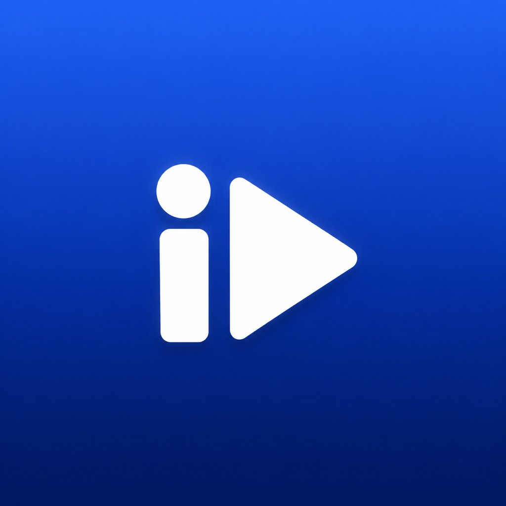

# Orion Subtitles

تطبيق iPadOS أصلي لبث ألعاب PS5 داخل التطبيق عبر الشبكة المحلية، مبني على نواة chiaki-ng المفتوحة المصدر. يستهدف هذا المشروع أجهزة iPad فقط، وليس نسخة هاتف أو وضع توافق لهاتف.

> **حالة المشروع:** مرحلة الاتصال والبث أولًا. سيتم إضافة OCR والترجمة العربية بعد إثبات ظهور بث PS5 الحقيقي داخل Orion.

## الميزات الحالية

- فك ترميز HEVC/H.264 عتاديًا وعرض الفيديو عبر Metal.
- بث حتى 1080p60 حسب قدرات PS5 والشبكة.
- وضع ملء الشاشة مع الحفاظ على نسبة العرض أو التكبير لملء الشاشة.
- دعم DualSense وDUALSHOCK 4 وأجهزة التحكم المتوافقة مع iPadOS.
- استخدام شاشة اللمس كلوحة لمس عند توفر ذلك.
- اكتشاف PS5 على الشبكة المحلية أو إدخال عنوان IP يدويًا.
- الاقتران الرسمي عبر رمز Link Device في إعدادات PS5.
- إيقاظ PS5 من وضع الراحة عند تفعيل إعدادات الشبكة المطلوبة.
- واجهات SwiftUI متكيفة مع مساحة iPad واتجاهيه العمودي والأفقي.

الاتصال الحالي محلي عبر Wi‑Fi أو الشبكة المحلية. لا يتضمن هذا الإصدار تشغيل PSN Internet Play.

## المتطلبات

- جهاز iPad يعمل بنظام iPadOS 17 أو أحدث.
- جهاز PS5 محدث ومفعّل فيه Remote Play.
- حساب PlayStation نفسه المستخدم على PS5.
- DualSense أو يد تحكم متوافقة، لأن واجهة اللعب لا تعتمد على أزرار لمس كاملة.
- شبكة Wi‑Fi جيدة، ويفضل أن يكون PS5 متصلًا بالراوتر عبر Ethernet.

## التثبيت عبر Windows وSideStore

لا يحتاج بناء Orion إلى Mac محلي. يقوم GitHub Actions بتشغيل Xcode على خادم macOS سحابي وينتج ملفًا غير موقّع باسم `Orion-Subtitles.ipa`. بعد تنزيله إلى Windows، يمكن استيراده في SideStore على iPad، حيث يعيد SideStore توقيعه بحساب Apple المستخدم في التثبيت.

يجب أن يكون مستودع GitHub عامًا لاستخدام standard macOS runner المجاني وفق سياسة GitHub الحالية. من صفحة **Actions** اختر **Build Orion IPA**، ثم اضغط **Run workflow**. بعد نجاح التشغيل نزّل artifact باسم `orion-subtitles-ipa`، وافتح الملف المضغوط، ثم اختر `Orion-Subtitles.ipa` داخل SideStore.

يحتاج SideStore إلى iPadOS 15 أو أحدث، وحساب Apple، واتصال Wi‑Fi. الحساب المجاني له حدود Apple المعتادة، ومنها عدد التطبيقات الفعالة وفترة صلاحية التوقيع.

## تشغيل Orion على iPad

1. فعّل في PS5: **Settings › System › Remote Play › Enable Remote Play**.
2. إذا أردت الإيقاظ من وضع الراحة، فعّل أيضًا الاتصال بالإنترنت والسماح بتشغيل PS5 من الشبكة.
3. افتح Orion Subtitles على iPad واسمح له بالوصول إلى الشبكة المحلية.
4. أضف PS5 أو أدخل عنوان IP يدويًا.
5. افتح في PS5: **Settings › System › Remote Play › Link Device**.
6. أدخل رمز الاقتران في Orion.
7. اتصل بيد التحكم واضغط **Play**.

يجب أن يظهر فيديو اللعبة الحقيقي داخل Orion. ظهور شاشة التطبيق وحدها لا يثبت نجاح Remote Play.

## الاختبارات المطلوبة قبل OCR

يتحقق Workflow تلقائيًا من أن IPA الناتج يحتوي على تطبيق iPad فقط، وأن اسم التطبيق `Orion Subtitles`، وأن Bundle ID موجود وصالح ومطابق لمعرف البناء. بعد تثبيت IPA على iPad يجب اختبار اكتشاف PS5 والاقتران وظهور الفيديو والتحكم.

لن نضيف OCR قبل إثبات وصول إطارات البث إلى التطبيق. بعد ذلك ستُضاف منطقة نص قابلة للتحريك، ثم Apple Vision OCR، ثم مزود ترجمة عربي لا يحتوي مفتاحًا سريًا داخل التطبيق.

## بنية المشروع

- `ChiakiKit/`: بناء iOS لنواة chiaki-ng والجسر C المستخدم من Swift.
- `App/Chiaki/`: اكتشاف PS5 والتسجيل والاقتران وتسجيل الدخول.
- `App/Streaming/`: جلسة البث وفك الترميز والصوت والرسم وإدخال التحكم.
- `App/Views/`: واجهات SwiftUI المتكيفة مع iPad.
- `scripts/build-chiaki.sh`: بناء XCFramework على macOS.
- `scripts/package-ipa.sh`: إنتاج IPA غير موقّع.
- `scripts/verify-ipad-ipa.sh`: فحص IPA بعد البناء.
- `.github/workflows/build-orion-ipa.yml`: البناء السحابي والتحقق ورفع artifact.

## الترخيص

يحتوي Orion Subtitles على أجزاء من iPlay5 وchiaki-ng وMbed TLS وOpus ومكونات أخرى بتراخيصها الخاصة. النواة والتعديلات الرئيسية موزعة وفق AGPL-3.0. يجب مراجعة ملفات الترخيص ونشر المصدر المطلوب عند توزيع نسخة معدلة.

Orion Subtitles غير تابع لشركة Sony Interactive Entertainment وغير معتمد منها. PlayStation وPS5 وDualSense علامات تجارية مملوكة لأصحابها.
